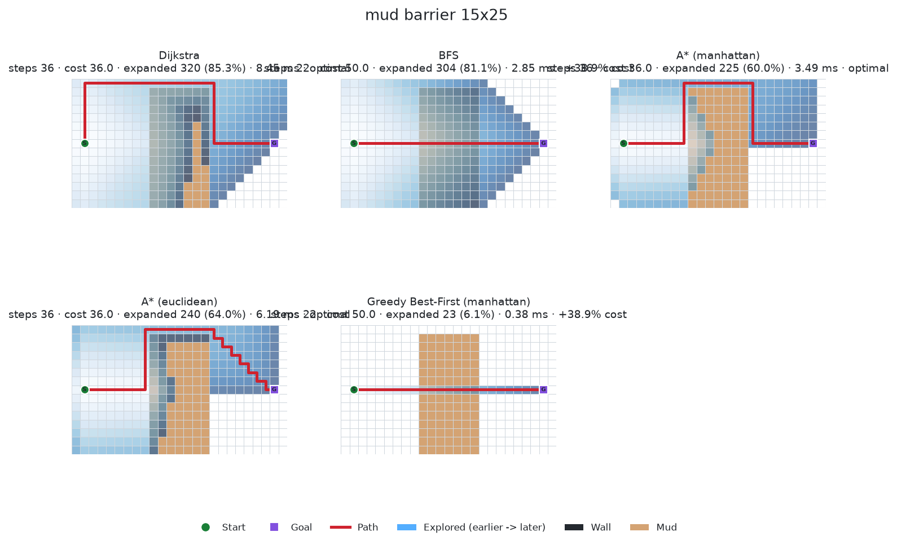
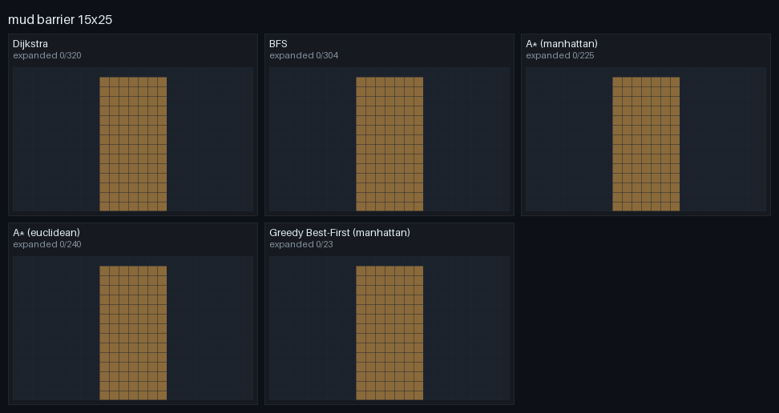

# Heuristic Graph Pathfinding Agent

Reproducible graph search algorithms, admissible heuristics, empirical benchmarking, and interactive visual analytics on discrete grid topologies.

---

## What It Is

The **Heuristic Graph Pathfinding Agent** is a pure Python pathfinding and benchmark suite implementing foundational graph search algorithms from scratch without external graph libraries. It evaluates how informed heuristics alter search frontiers, compares step-minimal paths against cost-minimal paths in weighted terrains, analyzes wall-clock execution vs. node expansion trade-offs, and provides visual and animated diagnostic artifacts through an interactive Streamlit application and automated report generator.

---

## Features

- **4 algorithms implemented from scratch**: Dijkstra's Algorithm, A* Search, Breadth-First Search (BFS), and Greedy Best-First Search with zero third-party graph dependencies.
- **5 distance heuristics**: Manhattan, Euclidean, Octile, Chebyshev, and the uninformative Zero heuristic ($h=0$).
- **4- and 8-direction movement**: Orthogonal and diagonal transitions with strict corner-cutting avoidance.
- **Weighted terrain support**: Multi-cost grid environments featuring uniform traversals, non-traversable walls, and weighted mud patches.
- **8 benchmark scenario categories**: Small open validation, obstacle density sweeps, grid dimension sweeps, spanning tree perfect mazes, concave traps, mud barriers, unsolvable configurations, and inadmissible heuristic demonstrations.
- **Built-in correctness guards**: Rigorous invariant checking, cell-by-cell path validation, independent BFS ground-truth cross-checks, and consistency verification.
- **GIF animations & algorithm race**: Frame-by-frame frontier exploration animations and synchronized multi-algorithm race visualizations.
- **Interactive Streamlit web app**: Complete UI featuring a single-algorithm Playground, side-by-side Compare view, Benchmark experiment runner, and Insights dashboard.
- **Automated publication-ready reports**: Headless analytical engine generating comprehensive Markdown reports with statistical findings and charts.

---

## Visualizations





---

## Results at a Glance

### Trap Scenario (12x20)
In the 12x20 concave trap scenario, every algorithm discovers the optimal 27-step path, but informed heuristics dramatically prune the search space by bypassing the dead-end cup:

| Algorithm | Nodes Expanded |
|:---|---:|
| BFS | 216 |
| Dijkstra | 216 |
| A* (Manhattan) | 186 |
| A* (Euclidean) | 204 |
| A* (Zero) | 216 |
| Greedy Best-First | 95 |

### Mud Barrier Scenario (15x25)
In the 15x25 mud barrier scenario, step minimization diverges sharply from cost minimization across weighted terrain:

| Algorithm | Nodes Expanded | Steps | Path Cost |
|:---|---:|---:|---:|
| BFS | 304 | 22 | 50.0 |
| Dijkstra | 320 | 36 | 36.0 |
| A* (Manhattan) | 225 | 36 | 36.0 |
| A* (Euclidean) | 240 | 36 | 36.0 |
| A* (Zero) | 320 | 36 | 36.0 |
| Greedy Best-First | 23 | 22 | 50.0 |

> **Key Takeaway**: Fewer steps is not lower cost, and fewer expansions is not always less wall-clock time in pure Python.

---

## Installation

Ensure Python 3.11 is installed on your system:

```bash
# Clone repository and enter directory
cd Pathfinding-Agent

# Create and activate virtual environment
python3.11 -m venv .venv
source .venv/bin/activate

# Install project dependencies
pip install -r requirements.txt
```

---

## Usage

```bash
# Launch the interactive Streamlit dashboard
streamlit run app.py

# Run the standard benchmark suite across all 42 scenarios
python -m src.benchmark --run standard

# Build the publication Markdown report and copy documentation assets
python -m src.report --build --docs

# Generate standalone animated GIFs for specific scenarios
python -m src.animator --scenario mud_barrier
```

---

## Tests

Every module contains an independent self-test suite runnable directly from the project root:

```bash
python -m src.grid
python -m src.heuristics
python -m src.algorithms
python -m src.benchmark
python -m src.visualizer
python -m src.animator
python -m src.app_logic
python -m src.report
python -m tests.smoke_test_app
```

---

## Project Structure

```text
Pathfinding-Agent/
├── .streamlit/
│   └── config.toml          # Streamlit theme configuration
├── assets/
│   └── style.css            # Dark minimal styling refinement
├── docs/                    # Tracked documentation figures and GIF assets
│   ├── benchmark_cost_quality.png
│   ├── benchmark_expansion_efficiency.png
│   ├── benchmark_runtime_vs_expansions.png
│   ├── mud_barrier_comparison.png
│   └── mud_barrier_race.gif
├── outputs/                 # Git-ignored local run logs, charts, and animations
│   ├── animations/
│   ├── charts/
│   ├── logs/
│   ├── paths/
│   └── report/
├── src/
│   ├── algorithms.py        # Dijkstra, A*, BFS, Greedy search algorithms
│   ├── animator.py          # GIF animation and algorithm race generator
│   ├── app_logic.py         # Pure UI-independent application logic
│   ├── benchmark.py         # Automated benchmark execution engine
│   ├── grid.py              # Grid data structure and procedural maze generators
│   ├── heuristics.py        # Distance heuristics and admissibility checks
│   ├── report.py            # Headless Markdown report exporter & findings engine
│   ├── ui_bench.py          # Benchmark and Insights Streamlit pages
│   ├── ui_common.py         # Reusable Streamlit UI layout & CSS helpers
│   └── visualizer.py        # Matplotlib static path, grid, and chart renderers
├── tests/
│   └── smoke_test_app.py    # Headless AppTest UI verification suite
├── app.py                   # Main Streamlit web application entrypoint
├── requirements.txt         # Project dependencies
├── README.md                # Project documentation
└── .gitignore               # Git ignore rules
```

---

## How Correctness Is Verified

1. **Cell-by-cell path validation**: Every single path is checked against the grid to guarantee start-to-goal continuity, walkability, boundary adherence, and that diagonal transitions never cut corners.
2. **Independent baseline check**: Dijkstra is checked against an independent BFS on 20 random grids to verify step and cost optimality.
3. **A* zero-heuristic identity**: A* with the zero heuristic ($h=0$) must explore identical states and return identical costs to Dijkstra.
4. **Consistency invariant**: Consistent heuristics ($h(u) \le c(u, v) + h(v)$) never re-expand any node; maximum expansion count per node is exactly 1.
5. **Strict optimality guard**: Any algorithm claiming an optimal path with a cost strictly less than Dijkstra's immediately aborts the benchmark with a `RuntimeError`.

---

## Limitations

1. Timings come from one machine and pure Python; median-of-N with GC disabled reduces but does not remove noise, so compare expansions first and runtimes second.
2. Expansion counts depend on tie-breaking (insertion order); another tie-break rule changes counts but never path cost for admissible A*.
3. Grids are small (up to ~100x100 in the standard suite) and obstacle density stops at 35% because 4-direction random grids near 40% are almost never solvable (percolation threshold).
4. Only uniform random obstacles, perfect mazes, one trap and one mud barrier are tested; real maps have different structure.
5. Terrain costs are limited to 1 (free) and 5 (mud); diagonal moves cost $\sqrt{2}$ times the terrain cost and never cut corners.
6. Results describe the seeds and parameters in `run_log.json`, not all possible grids.

---

## Requirement Checklist

| Requirement | Satisfying Module | Description |
|:---|:---|:---|
| Heuristic algorithms from scratch | [`src/algorithms.py`](src/algorithms.py), [`src/heuristics.py`](src/heuristics.py) | Dijkstra, A*, BFS, and Greedy Best-First with Manhattan, Euclidean, Octile, Chebyshev, and Zero heuristics. |
| Varying obstacle arrays | [`src/grid.py`](src/grid.py) | Procedural generators for uniform random percolation arrays, recursive backtracking perfect mazes, concave dead-end traps, mud barriers, and isolated unsolvable grids. |
| Metric tracking (steps, runtime, density) | [`src/algorithms.py`](src/algorithms.py), [`src/benchmark.py`](src/benchmark.py) | Precise step count, path cost, nodes expanded, nodes generated, max frontier size, expanded density %, and microsecond runtimes. |
| Exported visualization logs & UI | [`src/visualizer.py`](src/visualizer.py), [`src/animator.py`](src/animator.py), [`src/report.py`](src/report.py), [`app.py`](app.py) | High-resolution static path plots, synchronized animated race GIFs, multi-faceted benchmark charts, and interactive Streamlit lab. |
